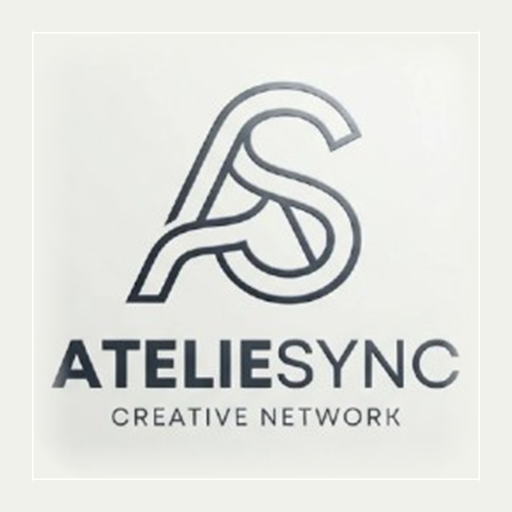
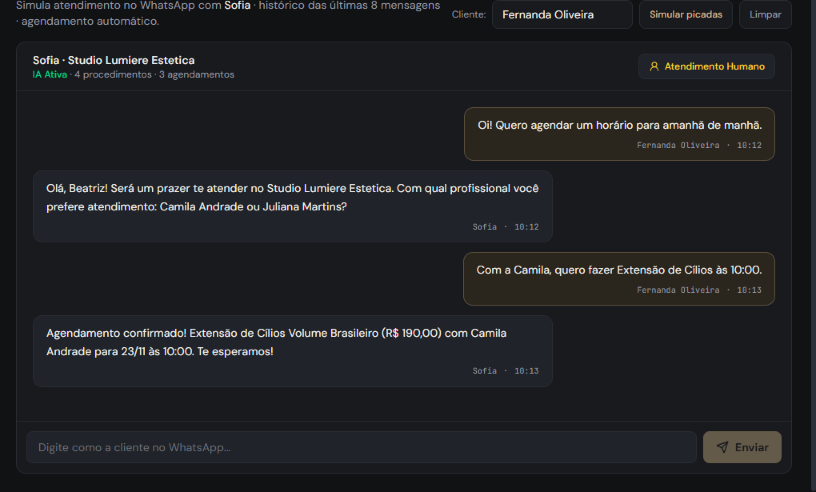
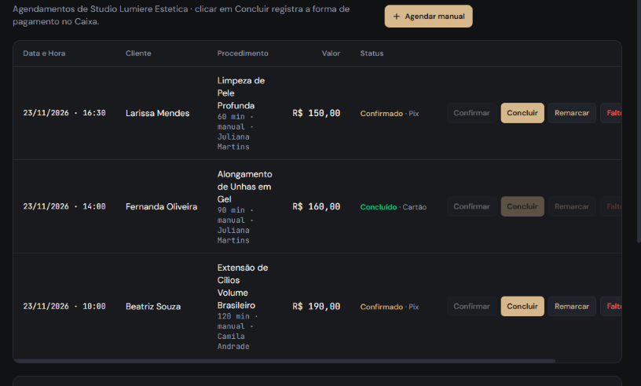
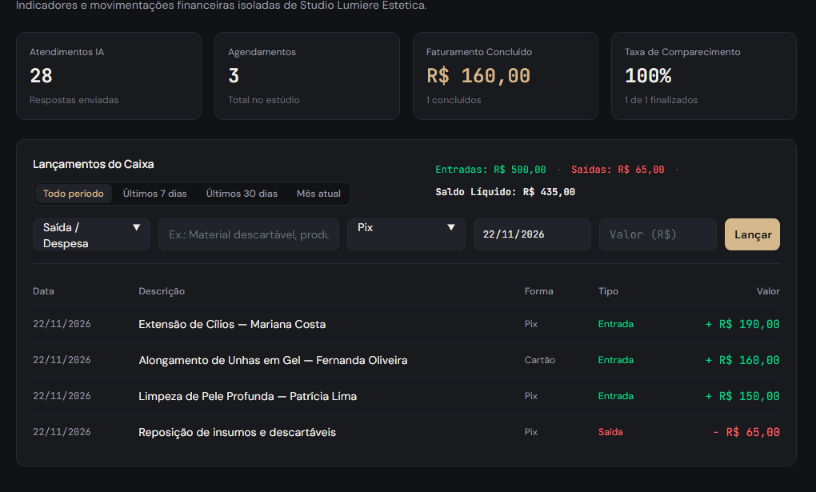

  
  <h1>AteliêSync — Plataforma SaaS Multi-Tenant de Atendimento WhatsApp com IA, Agenda e Caixa</h1>
  
<strong>Projeto de Portfólio · Desenvolvido por Ariell Arthur (B Tech Solutions)</strong>

  

    <a href="https://ariellpureza61.github.io/ateliesync-portfolio/"><strong>🌐 Acessar Demo Online Interativa</strong></a> •
    <a href="./AtelieSync_Portfolio_Ilustrativo.pdf"><strong>📄 PDF One-Pager Ilustrativo</strong></a>
  

  

    <em>⚠️ Nota: Todas as telas, nomes de estúdios, clientes, valores, profissionais e métricas apresentados neste repositório e na demo online são <strong>100% fictícios e meramente ilustrativos</strong>.</em>
  

---

## 🎯 Problema Resolvido

Estúdios de estética, clínicas e salões de beleza perdem clientes todos os dias por demorarem a responder no WhatsApp durante atendimentos presenciais, além de sofrerem com conflitos de horários entre profissionais e falta de controle financeiro entre agendamentos e caixa.

O **AteliêSync** transforma o WhatsApp do estabelecimento em uma **Recepcionista Virtual 24/7 com Inteligência Artificial**, integrada diretamente à agenda individual de cada profissional e ao fluxo de caixa do estúdio.

---

## ✨ Principais Funcionalidades

- **Atendimento IA 24/7 no WhatsApp:** Responde dúvidas de serviços, valores e durações com base exclusiva no catálogo configurado pelo estúdio.
- **Agendamento Inteligente Multi-Profissional:** Quando há mais de um profissional ativo, a IA pergunta primeiro com quem o cliente deseja atendimento, valida conflitos na agenda individual e respeita horário de almoço, feriados e dias fechados.
- **Regras Personalizáveis pelo Cliente:** Painel intuitivo para adicionar/excluir regras de atendimento, configurar intervalo de almoço, bloquear datas de feriado e habilitar pedido opcional de foto de referência.
- **Transbordo Humano Isolado + Alertas:** Pausa a IA apenas no número do cliente que solicitou atendimento humano (mantendo os demais normalmente) e dispara alerta automático no WhatsApp da gestora e notificação *push* no navegador/PWA.
- **Agenda → Caixa em 1 Clique:** Ao concluir um atendimento (`Pix`, `Cartão` ou `Dinheiro`), o valor entra automaticamente no resumo financeiro e nos KPIs do estúdio.
- **PWA Instalável (iOS e Android):** Responsivo para celular com atalho em alta resolução para a tela inicial.

---

## 📸 Visão Geral da Plataforma *(Dados Meramente Ilustrativos)*

### 1. Assistente IA Conduzindo Agendamento no WhatsApp

### 2. Agenda Multi-Profissional Sem Conflitos

### 3. Indicadores Financeiros e Caixa Integrado

---

## 🏗️ Arquitetura & Stack Tecnológica

- **Frontend:** React 19, TypeScript, Vite, Tailwind CSS, PWA (`manifest.webmanifest` + Apple Touch Icons)
- **Backend / APIs Serverless:** Node.js + TypeScript (APIs REST autenticadas e Webhook receptor)
- **Inteligência Artificial:** Google Gemini API (`@google/genai`) com *function-like* JSON estruturado, cadeia de fallback de modelos e validação determinística no servidor
- **Autenticação & Banco de Dados:** Supabase Auth (JWT multi-tenant com isolamento estrito por `tenant_id`)
- **Gateway WhatsApp:** Evolution API v2 + PostgreSQL 16 + Caddy 2 (HTTPS automático) em container Docker
- **Infraestrutura Cloud:** Vercel (Frontend + Serverless) + VM Linux (`Ubuntu 24.04 LTS`, Docker Compose)

---

## 📄 Apresentação Executiva (One-Pager Ilustrativo)

Acesse o PDF ilustrativo de apresentação da solução: [AtelieSync_Portfolio_Ilustrativo.pdf](./AtelieSync_Portfolio_Ilustrativo.pdf)

---

> *Este repositório tem finalidade exclusivamente demonstrativa para portfólio profissional. Credenciais, chaves de API e código proprietário de produção não são expostos aqui.*
